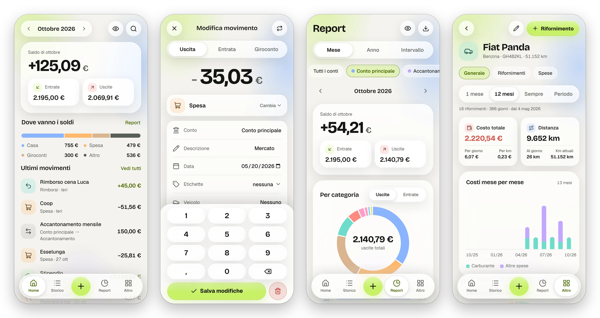
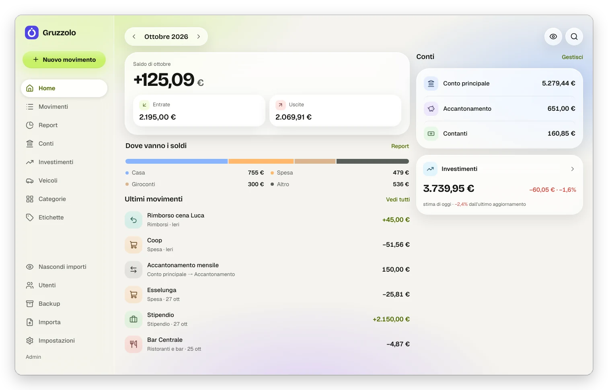
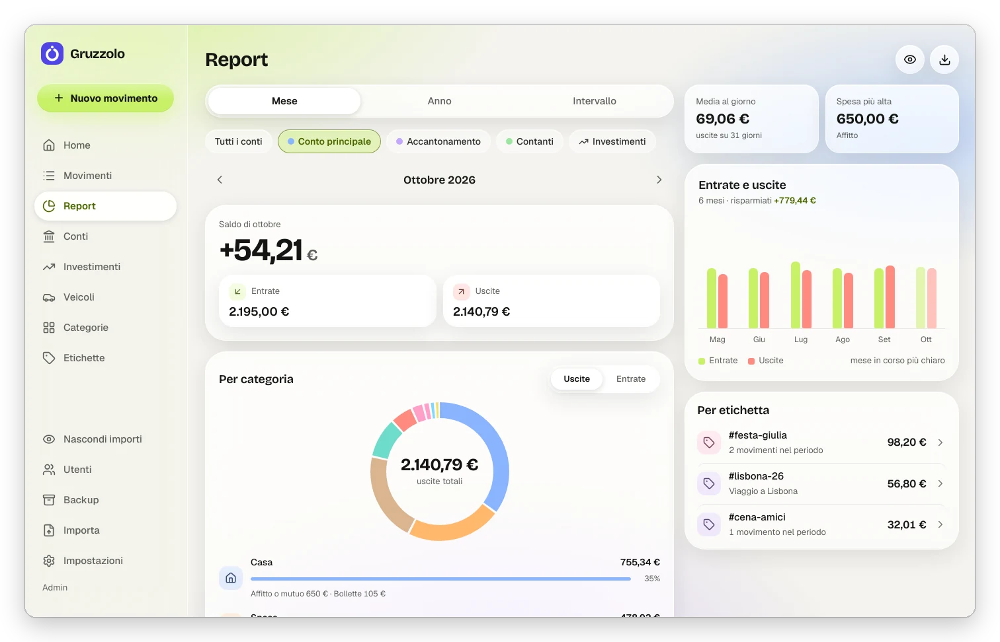
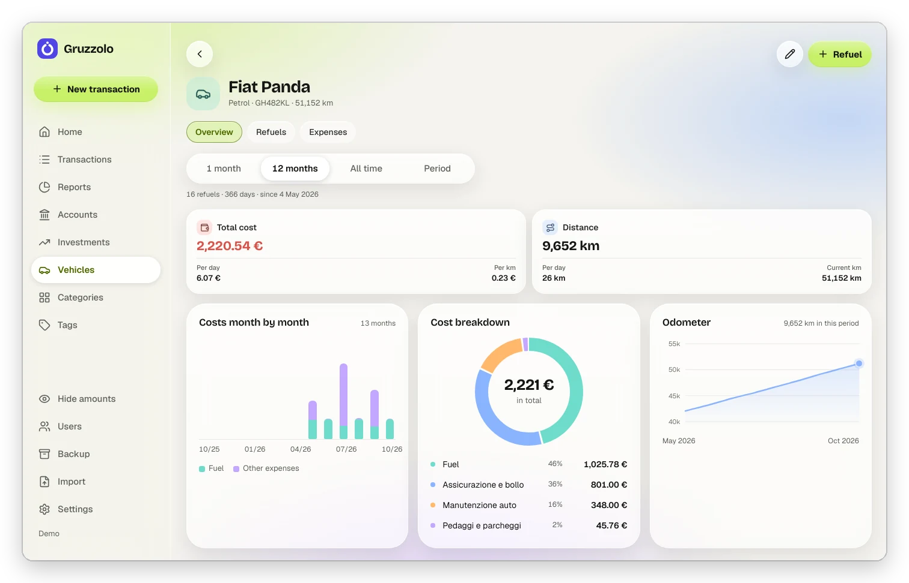
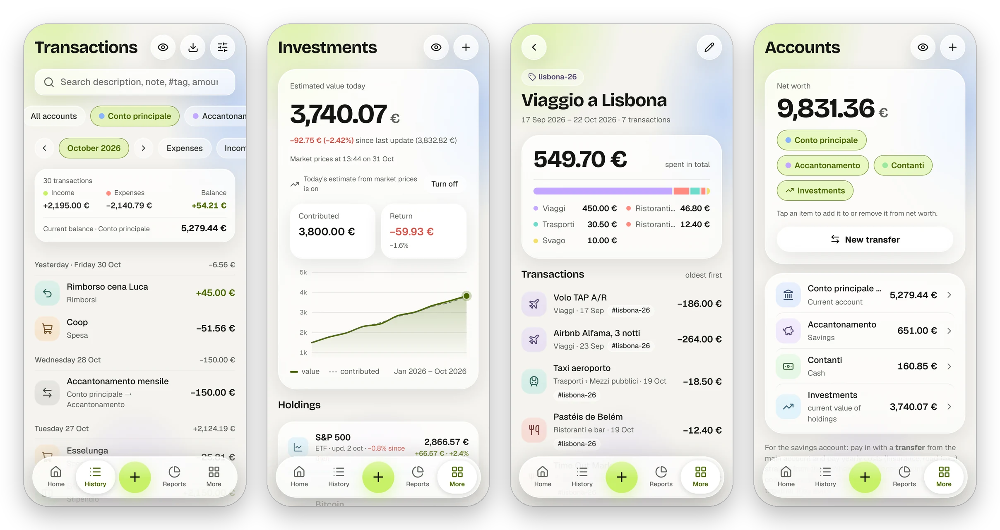
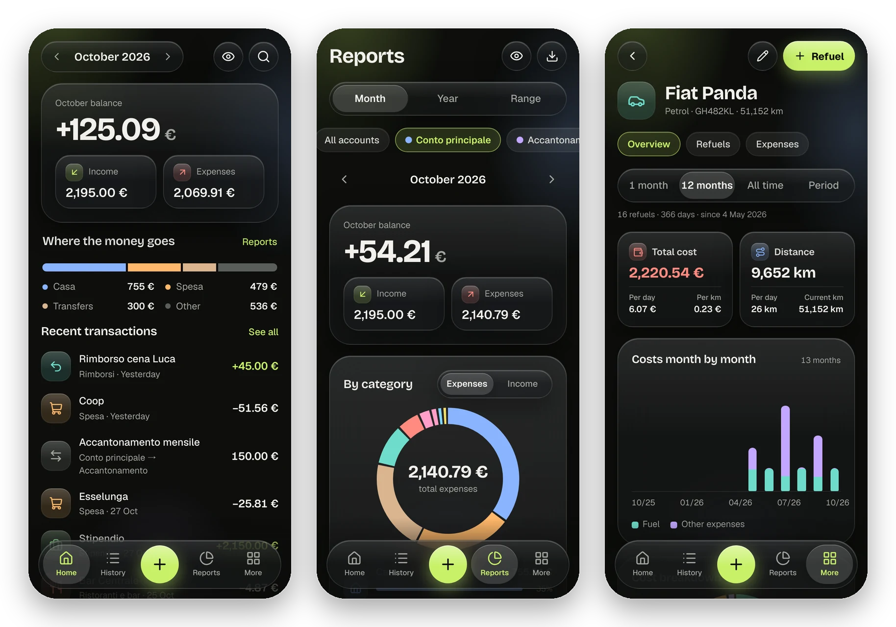

<p align="center">
  
</p>

<h1 align="center">Gruzzolo</h1>

<p align="center">
  A self-hosted, multi-user personal finance manager.<br>
  Income, expenses, shared accounts, reports, vehicle running costs and investments, in a web app you can install on your phone.
</p>

<p align="center">
  
  
  
  
  
</p>

<p align="center">
  
</p>

> *Gruzzolo* is Italian for "nest egg". The interface speaks English, Italian, Spanish, German and French.

## Features

- **Transactions** — income, expenses and transfers between accounts, with categories and
  subcategories, tags (`#trip`, `#party`…), notes and search. On phones the amount is typed on the
  app's own keypad.
- **Accounts** — checking, savings, cash; always up-to-date balances and overall net worth.
  An account can be **shared** with other users (e.g. a household account), together with its categories.
- **Reports** — month, year or any date range, across one or more accounts: spending by category,
  income and expenses over recent months, daily average, largest expense, spending by tag and
  investment returns.
- **Vehicles** — fuel economy computed from full tank to full tank, cost per km and per day,
  estimated range; any expense (road tax, servicing, tolls…) can be linked to a vehicle.
- **Investments** — contributions, withdrawals and value of each holding, returns and an
  **estimate of today's value** based on market prices.
- **Import** from Spendee, Wallet (BudgetBakers) and Money Manager, with undo; **backup and
  restore** of the whole instance from a single file.
- **Make it yours** — light, dark or automatic theme, classic or *Liquid Glass* style, accent colour
  and app icon of your choice, and a one-tap toggle to blur amounts when you're in public.
- **Five languages** — English, Italian, Spanish, German and French, picked from the browser or in
  Settings; numbers, dates and the amount keypad follow the language (`1,247.80 €`, `1.247,80 €`, `1 247,80 €`).
- **PWA** — add it to your home screen and use it like a native app, with pull-to-refresh.

## Screenshots

**Desktop**

<p align="center">
  
</p>

<details>
<summary>Reports and vehicles on desktop</summary>
<br>
<p align="center">
  
  
</p>
</details>

**History, investments, tags and accounts**

<p align="center">
  
</p>

**Dark theme**

<p align="center">
  
</p>

<sub>Screenshots show the English interface in the Liquid Glass style, with the sample data from `app:demo` (created in Italian).</sub>

## Try it locally

All you need is Docker.

```bash
git clone https://github.com/samuelemarini/Gruzzolo.git && cd Gruzzolo
cp .env.example .env          # set DB_PASSWORD
echo "APP_SECRET=$(openssl rand -hex 16)" > app/.env.local && chmod 644 app/.env.local
docker compose up -d --build  # web on http://localhost:20029, MariaDB on 30029
docker compose exec -u application -w /app web composer install
docker compose exec -u application -w /app web php bin/console doctrine:migrations:migrate -n
# "demo" / "demo1234" user with six months of sample data
docker compose exec -u application -w /app web php bin/console app:demo
```

Then open <http://localhost:20029> and sign in with `demo` / `demo1234`.

More commands (always as the `application` user, otherwise the cache becomes unreadable for php-fpm):

```bash
# a real user (prompts for the password); --admin lets them create other users from the app
docker compose exec -u application -w /app web php bin/console app:user:create mario "Mario" --admin
```

## Tech

Symfony 8.1 + MariaDB, AssetMapper (no Node, no build step), Turbo + Stimulus. Charts are SVG
rendered on the server. Fonts (Geist, Bricolage Grotesque) and icons (Lucide) ship with the
repository: nothing is loaded from a CDN and there is no tracking.

## Production (Portainer, stack from Git)

Compose file: `docker-compose.prod.yml`. Stack variables:

| Variable | |
|---|---|
| `DB_PASSWORD` | required, letters and digits only |
| `APP_SECRET` | required, `openssl rand -hex 16` |
| `ADMIN_PASSWORD` | creates the `admin` user on first start (change it later from Settings) |
| `TUNNEL_TOKEN` | required, Cloudflare tunnel token (Zero Trust › Networks › Tunnels) |
| `WEB_PORT`, `DB_PORT`, `DB_BIND` | optional, defaults 8080 / 3308 / 127.0.0.1 |

On start-up the container runs the migrations (`docker/entrypoint.d/60-gruzzolo.sh`). The code is
baked into the image: after updating the repository, use "Pull and redeploy" with a rebuild.
The site is exposed to the Internet through a Cloudflare tunnel (the `cloudflared` service): in the
tunnel's *Public Hostname* the service is `http://web:80`, with no ports to open on your router. The
tunnel's `X-Forwarded-*` headers are trusted (`TRUSTED_PROXIES=private_ranges`), otherwise login
would fail the CSRF check.

Backups: the `db_data` volume, `mariadb-dump` from the `database` container, or the app's own
backup (More › Backup, see below). To move data between instances (e.g. development → production):
download the backup from one and restore it on the other.

## How the app works

- **Transactions**: the amount is always positive, the type gives the sign. **Transfers** move money
  between accounts (or into an investment). In totals (Home, Transactions, Reports) they count from
  the point of view of the accounts in scope — the filtered ones, the ones shown on the home page, or
  all of them: money leaving is an expense (the "Transfers" slice), money arriving from outside is
  income, and transfers between two accounts in scope don't count. Same rule in `ReportService` (SQL)
  and `MovementRepository::totals()`.
- **Accounts**: balance = opening balance + income − expenses ± transfers. A savings account is fed by
  transfers and yearly expenses are paid straight from it.
- **Refuels**: a category with the "Fuel" option (by default *Transport › Fuel*). Two of the three
  values price/litres/total are enough. Fuel economy is computed from full tank to full tank (partial
  top-ups included); "I skipped a refuel" breaks the chain. Any expense can be linked to a vehicle to
  get the total cost per km. The vehicle page has Drivvo-style statistics in three tabs (Overview,
  Refuels, Expenses): cost per day and per km, volumes, min/max price and economy, km and days between
  refuels, estimated range (needs the tank capacity), indicators for the last fill-up and monthly
  charts. The cost per km of each fill-up uses the pump price, not the amount paid.
- **Investments**: for each holding you record contributions/withdrawals and its current value.
  Return = latest value − sum of contributions. A contribution can come from an account (a transfer,
  not an expense).
  **Estimated value today**: between updates, the latest recorded value is multiplied by the change in
  market price since that day (`MarketPrices` on Yahoo Finance, free and unofficial; prices in other
  currencies converted to euro; 20-minute cache). The ticker is set on the holding (e.g. SWDA.MI,
  BTC-EUR) or looked up from the ISIN. If the service doesn't answer, the latest recorded value is used.
- **Pull to refresh** (touch, `assets/pull_refresh.js`): from the top of the page it reloads with
  Turbo. Disabled in forms (`form.form`), in `<dialog>` panels and on `[data-no-pull]`; the browser's
  native pull-to-refresh is turned off with `overscroll-behavior-y` so the page doesn't reload twice.
- **Show on home**: each user chooses which accounts count towards the home totals (table
  `account_home_hidden`): an excluded account stays in the Accounts list with its balance, but its
  transactions are left out of the monthly totals, "Where the money goes" and the latest transactions.
  The owner sets it when editing the account, users it's shared with from the account page.
- **Accounts in Transactions and Reports**: by default only the main account (`?account[]=…` to pick
  others, `?account=all` for all of them; `MovementFilter::accountsFrom()`). Links from the home page
  carry the same accounts as the home totals.
- **Net worth** (Accounts page): account balances plus the current value of investments; chips choose
  what to include (e.g. leave out the joint account). The choice is per user
  (`app_user.net_worth_excluded`, excluded items: account ids or "inv"), so a new account is included
  automatically.
- **Investments in Reports**: the "Investments" chip adds them like an account (`?account[]=inv`, also
  together with other accounts or `all`): contributions to holdings = income, withdrawals = expenses,
  one line per holding; a contribution from an account in scope is an internal move. The "Period
  return" card shows value at the start and end of the period, amount contributed and return
  (`ReportService::investmentPeriod()`).
- **Categories per account**: each account has its own categories (`category.account_id`); users
  sharing the account use and manage the same ones. In a new transaction the suggested categories
  follow the selected account. A new account can start from another account's categories, from the
  defaults, or empty; from the Categories page you can copy another account's categories at any time
  (without duplicates).
- **CSV import** (More › Import): recognises exports from **Spendee**, **Wallet (BudgetBakers)** and
  **Money Manager** (non-UTF-8 cells are read as Windows-1252 or Mac Roman). The file is parked in
  `app/var/imports`, the preview suggests the mapping (wallets → accounts, categories → categories with
  the same name in the target account, otherwise new ones created there; missing tags are created),
  then it's imported. Every row has a fingerprint (`movement.import_hash`): re-importing the same file
  skips duplicates. Every import can be undone, which also removes the categories, accounts and tags
  created for it if they're unused. A new format only needs a class implementing
  `App\Import\ImportFormat` (it registers itself). From the command line, on behalf of a user (the
  transactions are theirs): `php bin/console app:import <user> <file.csv> --account=<id> [--dry-run]`,
  and `--undo=<id>` to undo.
- **Backup and restore** (More › Backup, admins only; `BackupService`): a JSON file with every database
  table (read from `information_schema`, so a new table is picked up automatically), users and hashed
  passwords included, plus the list of migrations. Restoring **replaces everything**: a preview compares
  the rows in the file with the current ones, you confirm by typing `RIPRISTINA`, then in a single
  transaction the tables are emptied and the rows re-inserted with their ids (constraints off,
  references checked before commit: if anything doesn't add up, nothing changes). It rejects backups
  from a newer version of the app, unknown columns and files without an active admin; at the end it
  logs you out. `.json.gz` is accepted too. From the command line:
  `php bin/console app:backup:export [file.json|file.json.gz|-]` and `app:backup:restore <file> [--force]`.
- **Liquid Glass style** (Settings › Style, `app_user.style`): translucent glass surfaces à la
  iOS 26/27 on top of the light or dark theme. All in `assets/styles/glass.css`, scoped by
  `html[data-style="glass"]`: blur only on top-level surfaces (cards, bars, buttons), inner ones are
  just tinted; with `prefers-reduced-transparency` or without `backdrop-filter` the glass becomes
  almost opaque.
- **Hidden amounts**: the eye icon (Home, Transactions, Reports, Accounts, Investments, sidebar) blurs
  amounts on that device (`localStorage`). `assets/privacy.js` recognises amounts by their format
  ("1.247,80 €") and wraps them in `.money`; large balances are `.hero-amount__value`.
- **Languages**: the Italian sentence is the translation key (`{{ 'Nuovo movimento'|trans }}`), translations
  live in `app/translations/messages.{en,es,de,fr}.json`. The language comes from `app_user.locale` or, when
  empty, from the browser (`LocaleSubscriber`); separators per language are in `App\Service\Language` and
  are used by the Twig filters, `Money::parseLocal()` and `assets/i18n.js` (which also carries the few
  strings used by scripts). Entities and static code translate through `App\Util\Trans`. Default
  categories are created in the language of whoever creates the user; data already stored (account and
  category names, descriptions) is never translated.
- **Multi-user**: every table has an owner; controllers use `AppController::own()`, which returns 404
  for other users' data.
- **Shared accounts**: the owner shares an account with other users (table `account_member`, from the
  account's edit page). Members see the balance and transactions and add new ones with the account's
  categories; `movement.user` stays the author. Transaction visibility = accessible account
  (`AccountRepository::ACCESSIBLE_DQL/SQL`, `AppController::accessibleMovement()`); in reports,
  categories with the same name from both users are added together. Only the owner can edit or delete
  the account.

## Project layout

- `src/Service/ReportService.php` SQL aggregates for Home and Reports
- `src/Service/VehicleStats.php` vehicle fuel economy and costs
- `src/Service/InvestmentStats.php` returns for holdings and the portfolio
- `src/Service/ChartBuilder.php` geometry of the SVG charts (rendered on the server)
- `assets/styles/app.css` design system (light/dark tokens + components)
- `assets/controllers/` Stimulus: transaction form, keypad, refuel, tags, sheet
- `resources/icons/` the Lucide icons in use (`{{ icon('name') }}` in Twig)

## Credits

Icons by [Lucide](https://lucide.dev) (ISC, see `app/resources/icons/LICENSE-lucide`), fonts
[Geist](https://vercel.com/font) and [Bricolage Grotesque](https://github.com/ateliertriay/bricolage)
(SIL Open Font License). Market prices from Yahoo Finance (unofficial service).
